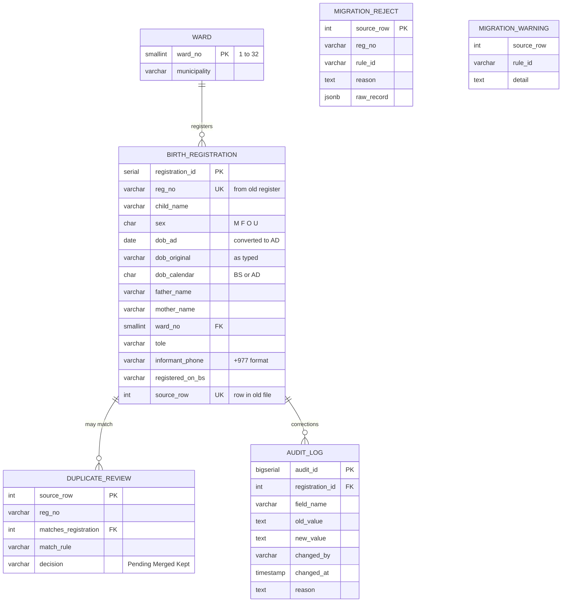

# Target Data Model

> **In simple words:** the old register was one big spreadsheet. The new design splits it into a few connected tables, and adds rules so bad data can't get in. Rows that fail a rule aren't thrown away; they go to a "reject" table for a person to fix.

Full PostgreSQL definition: [sql/schema.sql](../sql/schema.sql)

## Design decisions

| Decision | Why |
|---|---|
| Store the date of birth twice: converted AD date and the original text | AD dates can be sorted and compared; the original proves what the clerk wrote and lets anyone check the conversion |
| Record which calendar the original was in | Nobody has to guess later whether "2079/08/06" was BS |
| Keep `source_row` on every migrated record | Any record can be traced back to its exact row in the old file |
| Rejected rows kept with the full original record | Nothing is lost; a ward officer can fix and re-load them |
| Duplicates held for a person to decide | Two children can share a name, birthday and mother's name (twins), so a computer shouldn't merge them automatically |
| Database-level checks (ward 1–32, date not in future, phone pattern) | Bad data is blocked even if someone bypasses the application |
| Audit log with no update or delete permission | Every later correction is permanently recorded |
